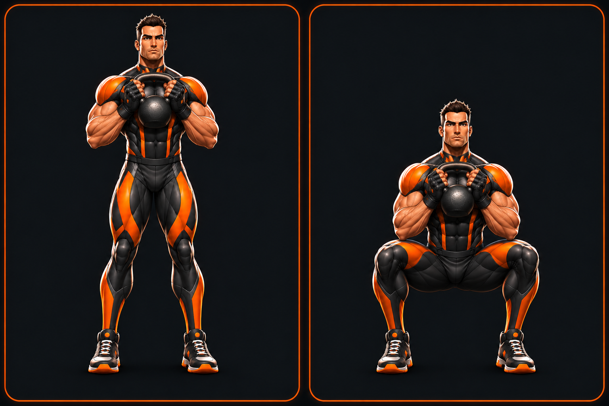

# Hero exercise artwork — first approval sample (#86)

Status: **pending owner visual approval**. This is the first sample only, not the completed exercise catalogue or a production guide replacement.

## Source and generation

Generated on 7 November 2026 using the built-in `image_gen` reference-image tool, which supports reference-image editing. Both exact repository images were supplied:

- `assets/hero-forge/references/character-front-back-options.png`: canonical identity sheet; male character in the left panel.
- `assets/hero-forge/app/male-front.png`: supporting production reference for the face, hair and armour details.

The generated sample is a new file. Existing approved assets, muscle overlays and application code are unchanged. See `prompt.txt` for the exact prompt. The two panels are intended to correspond to the existing `kettlebell-squat-1` and `kettlebell-squat-2` steps; they are not wired into the app before approval.

## Visual review

The sample retains the male hero's spiky brown hair, square face, muscular proportions, charcoal armour, orange shoulder/torso/leg panels, fingerless gloves and trainers. Both poses include the feet. The kettlebell is held at chest height, with planted heels and knees opened in the bottom pose. The result uses a frontal view rather than the requested subtle three-quarter view; squat depth and exact grip should be reviewed before this becomes instruction artwork. Character resemblance and anatomy are visual judgments, not automated guarantees.

## Discovery and scope

- Existing swipeable `ExerciseGuideSheet` owns the carousel, captions, step indicators and close/navigation behavior. Instructions and stable image IDs live in `src/exercises/library.json`; bundled SVG strings currently come from `illustrations.generated.ts`.
- Five guides exist: kettlebell squat, seated chest press, lat pulldown, seated cable row and hammer curl (two illustrated steps each).
- The inventory has 15 movements: knuckle push-up, chest press, lat pulldown, one-arm kettlebell row, goblet squat, leg extension, kettlebell Romanian deadlift, hammer curl, overhead press, plank, straight-leg raise, standing calf raise, heavy bag, VR boxing and battle ropes. Ten currently have no illustrated library guide. This gap must not be represented as completed coverage.
- The seed configuration includes Fortis multi-gym, 16/24 kg kettlebells, free weights, heavy bag, VR headset and battle ropes.
- All three existing hero types have front/back references. Only the male sample has been generated at this stage.
- No new controls, screen layers or vertical space are introduced. The application remains operational with its existing guide artwork.

## Next stage after explicit approval

Generate approved sequences across all three established heroes, add offline raster asset mappings to the existing guide, retain accessible captions/swiping/touch targets, update contract 09 for raster assets, and verify complete catalogue coverage and phone screenshots. No bulk generation or merge occurs before approval. Kevin authorized local execution in chat, superseding the issue's cloud-only execution request.

## Local validation

- PNG inspected visually: 1536 × 1024, 1,640,582 bytes; SHA-256 `2131856ada3e0fbf1adbd4ce526c7b9d37aa5bdd91131c4bbf9061b5bcf25941`.
- TypeScript, production web export, iOS Hermes export and Android Hermes export passed. These validate the unchanged application; the unapproved preview is deliberately not bundled yet. No APK or Play release was built.
- Existing exercise-library/guide unit checks: 15 passed.
- Full Jest: 727 passed, 1 failed (Windows slash normalization in `src/repo/__tests__/agentFiles.test.ts`).
- Full production browser suite: 422 passed, 106 skipped, 21 failed (17 screenshot comparisons, three clipboard/share assertions, one meal interaction). These occurred on unchanged application source and baselines; this preview does not claim to resolve them. Test-generated documentation screenshots were restored rather than included in this branch.
- Development-server smoke: 1 passed.
- Full logs remain locally in ignored `artifacts/issue-86-{jest,e2e,dev}.log`. No baseline refresh is appropriate for this preview-only change.
