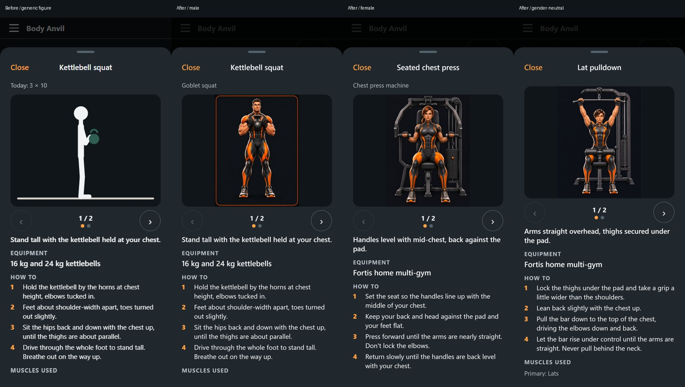

# Hero exercise guides — implementation (#86)

The real application's existing exercise guide now renders offline hero artwork. Open Today → workout → any exercise's **Show how**, or Menu → Muscle coverage → Log exercise → choose a movement → **Show exercise guide**. Swipe or use Previous/Next to browse the two illustrated positions.

Kevin explicitly requested full implementation in chat after the initial sample. That request supersedes the earlier preview pause. PR #87 is updated in place and remains unmerged.

## What changed

- Sixteen guides cover all 15 tracked inventory movements plus the existing legacy cable row. Each has two distinct illustrated steps, accessible captions and instructions. The one-arm row and other previously missing guides now contain real content.
- The existing male, female and gender-neutral heroes demonstrate different exercises. Assignments are fixed per exercise, so a sequence retains one character; the separate muscle artwork still follows profile information.
- `src/exercises/heroIllustrations.ts` uses static Metro asset requires. JPEGs and a pure metadata manifest are committed under `assets/exercises/heroes/`. Images load without external services or API keys on installed native apps.
- The guide keeps its 4:3 illustration budget, existing horizontal pager, step counts, captions, 48 px navigation, instructions, cautions, substitutions and Close behavior. Images preserve their proportions with `contain`; bodies are never stretched or cropped by the UI. Both selectable themes use the same character illustrations.
- Browsing remains read-only. No tracking state, goals, achievements, accounts or gamification are added. Conditioning still uses time-based logging. No muscle overlay is modified.

## Artwork provenance

Built-in `image_gen` performed genuine reference-image generation. It supports reference-image editing. Each exercise used the exact production hero front PNG from `assets/hero-forge/app/`; the original goblet-squat sample also used the canonical character sheet. Exact prompts and file hashes are recorded in `provenance.json`.

Generated two-panel sheets were split at their midpoint into separate real poses, proportionally downsampled to at most 768 × 1024, and encoded as JPEG for offline bundle size. This processing does not change a pose, anatomy or perspective. No CSS transforms, mirroring, generated stick figures or SVG simulation are used. The approved character source assets remain untouched.

The multi-gym images illustrate the relevant home-gym mechanism; they do not claim to reproduce a specific Fortis model's industrial design. Always use the existing text cues and configure the actual equipment correctly. AI artwork has been visually inspected for recognizable identity, correct movement, equipment contact and complete bodies; it is not an anatomical measurement.

## Review

See `contact-sheet.jpg` for all sequences and `screenshots/` for actual application guide screens at 360, 390 and 430 px. The before image is the pre-change `exercise-guide` screenshot from develop. Existing screenshots elsewhere are not refreshed for this change.

Contract 09 documents ownership, offline assets, catalogue coverage and accessibility. Automated checks cover library/schema validity, all inventory movements, two unique step images, all three character types, bundled file signatures/sizes, native paging, browser image loading and no tracking mutations while browsing.

## Final local checks

- `npm run typecheck`: passed.
- Web production export: passed through production Playwright setup.
- `npm run check:native`: passed for iOS and Android Hermes; all 32 hero JPEGs appear in exported assets. The production step images total about 2.4 MB. No new runtime dependency, account, remote image service or Play release.
- Full Jest: **730 passed, 1 failed**, 50 suites passed. The sole failure is the existing Windows slash-normalization fixture in `src/repo/__tests__/agentFiles.test.ts`, also reproduced before implementation. New artwork coverage and both native guide suites, including swipe/caption synchronization, pass.
- Full production browser regression: **425 passed, 106 skipped, 21 failed**. The same 21 failures were reproduced before implementation: 17 unrelated screenshot comparisons, 3 share/clipboard assertions, 1 meal interaction. No unrelated baseline was changed.
- Final focused guide/browser run after synchronizing screenshots with carousel settling: **13 passed, 2 configured skips**, no failures, across 360/390/430 px. It opens all 15 tracked movements, loads both distinct local JPEGs, checks 4:3 sizing and proves that browsing does not mutate tracking data.
- Development-server smoke: **1 passed**.
- The changed guide screenshot baseline was refreshed and visually reviewed. The before/after and all 18 phone screenshots were inspected; both poses match their captions after the pager settles.

Logs remain locally in ignored `artifacts/issue-86-impl-*.log`. These counts report remaining failures explicitly; the full repository suite is not entirely green.
