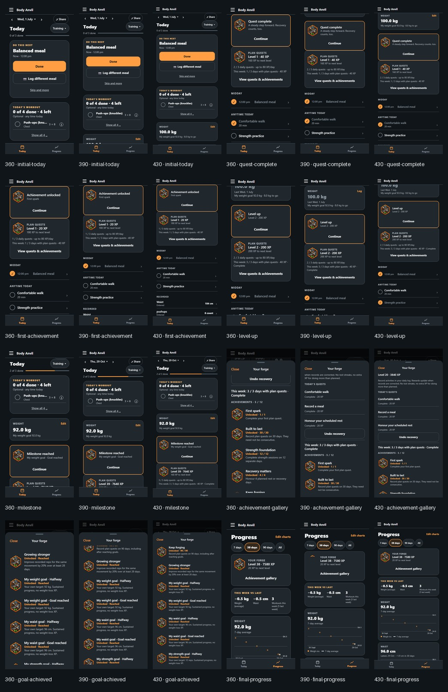

# Issue #73 · Optional gamification

The feature is opt-in under **Settings → Quests & achievements**. It extends Today and Progress using the canonical tracking store and preserves existing navigation and Plan/configuration access. See [the design contract](../../design-contracts/16-gamification.md) for scoring, safety rules, correction semantics, persistence and integration decisions.

## Journey evidence

The deterministic fictional adult starts at 100 kg, 104 cm waist and 8 push-ups, with a 180 cm height. Their own goals are 92 kg, 96 cm waist and 12 push-ups. The fixture covers 1 July–29 October 2026, then verifies continued XP beyond the goal. These targets describe the test user, not a universal target body.

Every Playwright context has isolated storage; no real records are read or changed. Fixed dates and synthetic canonical record checkpoints simulate months; real UI actions test onboarding, completion, measurement entry, recovery undo, preference persistence and celebrations. The existing browser Health Connect adapter injects fictional steps and runs the production sync/mapping/store path repeatedly. Separate browser assertions correct/delete steps, edit backdated meals and verify reward reversals without replay.

| Evidence | 360 px | 390 px | 430 px |
|---|---|---|---|
| Pass/fail report | [Report](360-journey-report.md) | [Report](390-journey-report.md) | [Report](430-journey-report.md) |
| Initial Today | [Screenshot](360-initial-today.png) | [Screenshot](390-initial-today.png) | [Screenshot](430-initial-today.png) |
| Quest complete | [Screenshot](360-quest-complete.png) | [Screenshot](390-quest-complete.png) | [Screenshot](430-quest-complete.png) |
| First achievement | [Screenshot](360-first-achievement.png) | [Screenshot](390-first-achievement.png) | [Screenshot](430-first-achievement.png) |
| Level up | [Screenshot](360-level-up.png) | [Screenshot](390-level-up.png) | [Screenshot](430-level-up.png) |
| Milestone | [Screenshot](360-milestone.png) | [Screenshot](390-milestone.png) | [Screenshot](430-milestone.png) |
| Gallery | [Screenshot](360-achievement-gallery.png) | [Screenshot](390-achievement-gallery.png) | [Screenshot](430-achievement-gallery.png) |
| Goal achieved | [Screenshot](360-goal-achieved.png) | [Screenshot](390-goal-achieved.png) | [Screenshot](430-goal-achieved.png) |
| Final Progress | [Screenshot](360-final-progress.png) | [Screenshot](390-final-progress.png) | [Screenshot](430-final-progress.png) |



## Changed surfaces · before and after at 390 px

| Surface | Before / off | After / enabled |
|---|---|---|
| Today | [Off](390-before-today.png) | [Quest and celebration](390-first-achievement.png) |
| Progress | [Off](390-before-progress.png) | [Gallery access](390-final-progress.png) |
| Settings | [Previous Settings](settings-before.png) | [Gamification switch](390-settings.png) |

The quest card is below existing priority content, so the initial Today screenshot intentionally preserves the main action and measurement hierarchy. The off state adds no Today spacing. Settings, gallery and full 390 px screens were visually inspected. Refreshed existing Playwright baselines also pick up earlier develop changes (Share, meal controls and theme edging); before/after comparisons were reviewed.

## Artwork

**Missing reference:** `achievement-reference.png` was absent from the repository. The owner's direct request explicitly authorized continuing from the written approved direction and existing Hero Forge assets. The new [production emblem](../../../assets/hero-forge/achievements/forge-emblem.png) uses industrial hexagonal metal, orange trim, cyan highlights and comic fitness illustration. It is shared across achievement and celebration panels, with accessible text identifying each achievement. It is not represented as the missing original reference. [Generation provenance and exact prompt](../../../assets/hero-forge/achievements/README.md).

## Reproduce

```powershell
npm.cmd run typecheck
npm.cmd test -- --runInBand --cacheDirectory .expo/jest --testTimeout=30000
$env:PFT_E2E_PORT='8193'
npm.cmd run test:e2e -- --workers=4 --timeout=120000
python scripts/issue-73-contact-sheet.py
$env:E2E_DEV='1'
$env:PFT_E2E_PORT='8192'
npx.cmd playwright test --timeout=180000
```

There is no lint script or ESLint configuration in this repository. TypeScript, repository guard tests and `git diff --check` provide the configured static checks. Native export uses a workspace temporary directory on this Windows host to avoid the sandbox's Hermes temporary-file restriction. Browser tests need local socket access. Run one production export/server at a time because each uses `dist/`.

Cosmetic progression is limited to the badge gallery and level recognition; existing hero illustrations are unchanged. Android/iOS JavaScript exports and platform-native tests supplement browser fixtures; a real Health Connect data-provider journey remains distinct from browser adapter verification. See the final validation report for exact results and native smoke-test scope.
