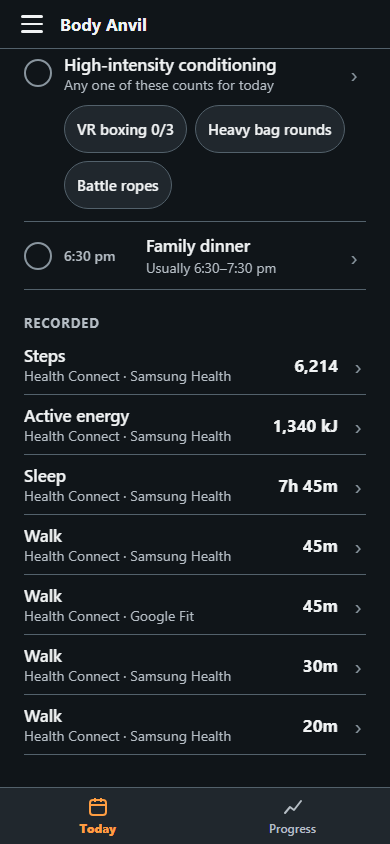
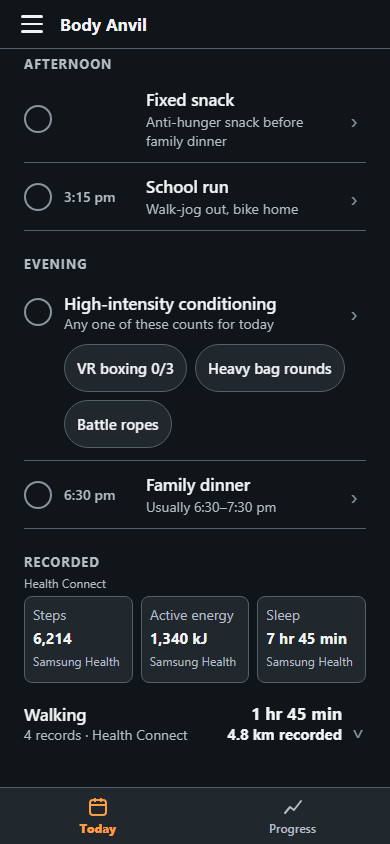
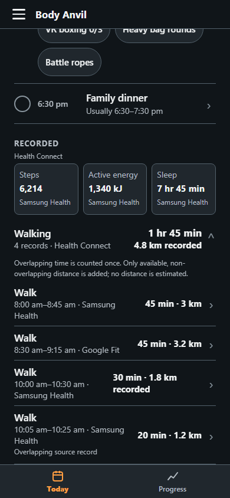
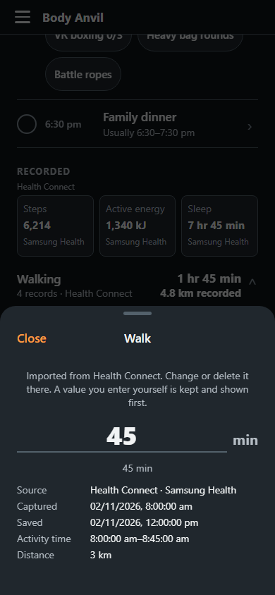
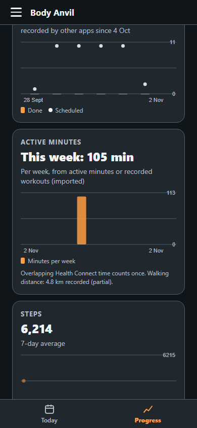

# Recorded walking — issue #104

Actual application captures with the isolated QA fixture in
`e2e/fixtures/walking-health-connect.json`, not personal tracking history.
The Body Anvil theme, artwork, app shell and Today header are retained.

| Before | After |
|---|---|
|  |  |

The four source records cover 08:00–09:15 and 10:00–10:30. Summing their
durations would incorrectly give 135 minutes; the union is 105 minutes
(`1 hr 45 min`). One nested record is identified as a source overlap. Both
partially overlapping records remain inspectable. The summary says **4 records**,
not four unique walks.

Only non-overlapping recorded distances contribute to the summary: 3,000 m and
1,800 m = **4.8 km recorded**. The overlapping 3,200 m and 1,200 m remain visible
on their individual records. Nothing is scaled, extrapolated or derived from steps.
With no distance supplied, only duration is shown.

The compact grid uses one shared Health Connect label and individual source names.
Tiles, walking expansion and source rows retain targets of at least 48dp.
Rows wrap essential values. The detail sheet scrolls with Close fixed.
Larger native font scales let tiles wrap to fewer columns.

## Data and permissions

Source IDs are retained. Shared pure projections handle duplicate counts,
interval union, conservative distance totals and legacy records without timings.
Today, Progress and the connection sheet use these projections. Incomplete
timings produce a labelled duration lower bound. Manual and screenshot records
keep their existing behavior.

SQLite migration 6 adds nullable activity facts, preserved in both stores and v1
export/restore. Existing observations are not rewritten by the migration.

Distance is a seventh, optional **read** permission. The six main types still
work if Distance is refused, revoked or fails. Existing connections can allow
Distance through Manage in Health Connect; sync never prompts automatically.
Only same-source Distance intervals fully contained in a workout are eligible.

Before Google Play release, update the Health Connect declaration for
`READ_DISTANCE` and verify the grant and source data on a physical phone
(contract 12). No route, background, history or write permission is added.
No Play changes or releases are submitted by this issue.

## Verification

- TypeScript: passed.
- Complete Jest suite: 768 tests, 58 suites passed (unit, Android and iOS).
- Final focused Jest run: 87 tests, 8 suites passed after the final unit/source-matching changes.
- Focused production E2E: 102 passed across 360, 390 and 430 px, covering Health Connect, walking, historical corrections, upcoming durations and scrolling.
- Android and iOS production bundle exports: passed.
- Development-server smoke: passed, including screenshot import.
- Complete exercise-guide inventory: passed on retry with a 120-second timeout (26.1 seconds).
- Refreshed and visually inspected only affected Health Connect and 10:45 upcoming-duration baselines. The unrelated 11:45 due-card baseline was retained.

The broad production E2E run was **not green**: 434 passed, 108 skipped, 25 failed
under concurrent native-build load. Three old `35m` assertions were corrected to
`35 min` and pass in the focused rerun. The scrolling and guide-inventory timing
failures also pass on retry. Other failures comprise 16 unrelated visual-baseline
comparisons, three browser clipboard cases and the small-phone meal-row case.
Those baselines and behaviors were not rewritten to make this issue pass.
