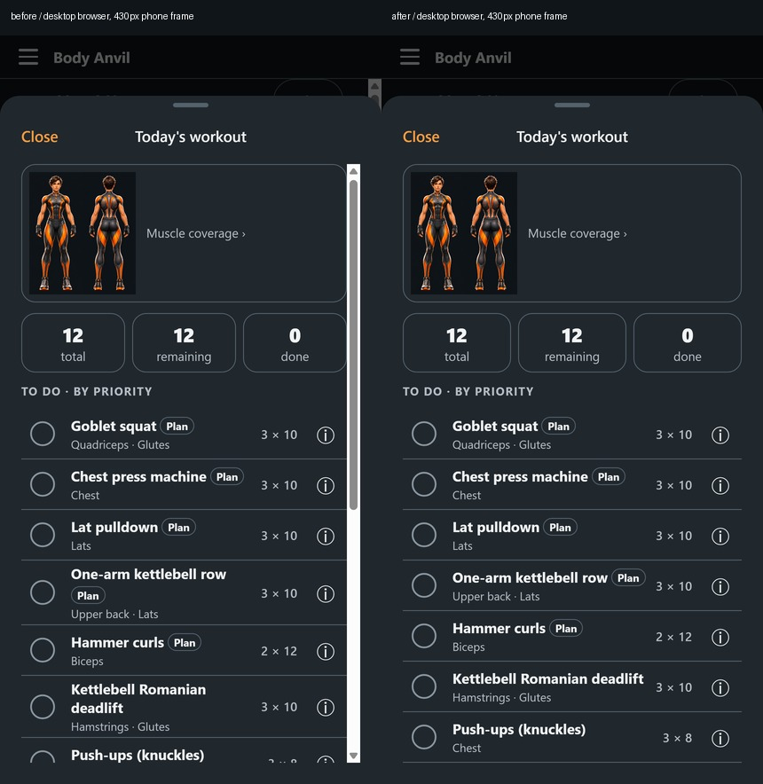
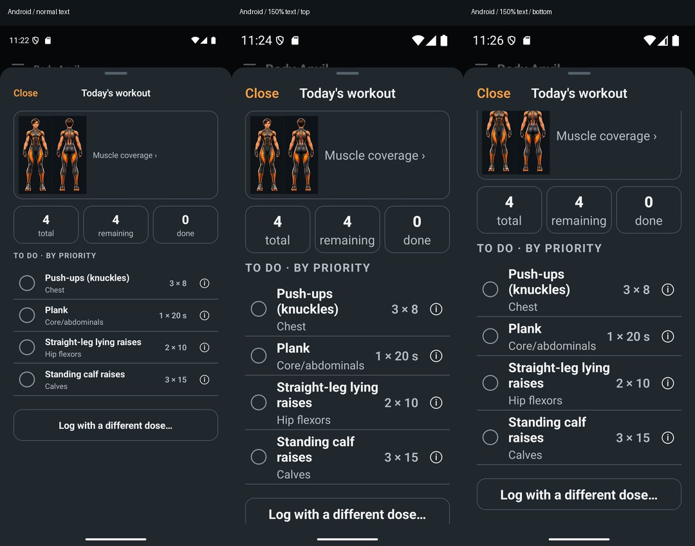

# Global scroll-indicator audit (#93)

Indicator-only change within existing layouts. No controls, headers, safe areas, keyboard avoidance, scroll ownership or content padding were moved. No additional fade, arrow or instructional label is introduced. The partial next row remains the content affordance. No exercise-plan logic from #90 is included.

## Repository audit

Searched production `app/` and `src/` for native ScrollView, FlatList, SectionList, VirtualizedList, web `overflow: auto/scroll`, shared sheets/modals, menus and multiline input. Found **13 ScrollViews in 12 feature files**, no virtualized lists and no custom DOM overflow scrollers. Before this fix all vertical scrollers inherited visible native/browser indicator defaults; the exercise pager explicitly hid only its horizontal indicator.

| Surface / source | Before | Fix | Verification |
|---|---|---|---|
| Daily Log — `DayLogScreen` | Vertical default | Shared ScrollView, both axes hidden | Browser audit, wheel/bottom reachability; existing Daily Log tests |
| Today's Workout exercise list — `TodayWorkout` | Thick vertical browser bar | Shared ScrollView, same fixed Close/header | Narrow-phone before/after top and bottom screenshots, wheel/keyboard/touch, final action reachable |
| Activity/session details — `ItemSheet` | Vertical default | Shared ScrollView | Existing workout/surface/responsive tests, native wrapper contract |
| Share this day — `ShareDaySheet` | Vertical default | Shared ScrollView | Existing share/surface tests, native wrapper contract |
| Progress — `ProgressScreen` | Vertical default | Shared ScrollView | Browser audit, existing Progress tests |
| Screenshot Import — `ImportScreen` | Vertical default | Shared ScrollView; keyboard props preserved | Browser audit, existing fixed Save/import tests |
| Configure — `ConfigureScreen` | Vertical default; textarea browser overflow | Shared ScrollView + root browser rule | Browser audit, long textarea keyboard scrolling and fixed action bar |
| Setup/edit answers — `WizardParts` | Vertical default on every wizard step | Shared ScrollView; existing keyed reset and keyboard props preserved | Browser audit, existing setup/responsive tests |
| Settings — `SettingsSheet` | Vertical default | Shared ScrollView | Browser audit/bottom, existing settings tests |
| Health Connect — `HealthConnectSheet` | Vertical default | Shared ScrollView | Browser audit/bottom, existing Health Connect tests |
| Muscle coverage, reports, exercise inventory/log form — `CoverageSheet` | Vertical default | Shared ref-preserving ScrollView | Browser audit/bottom, existing muscle/guide tests |
| Exercise guide instructions — `ExerciseGuideSheet` | Vertical default | Shared ScrollView | Nested guide browser audit, existing guide/responsive tests |
| Exercise guide horizontal pager — same file | Horizontal explicitly hidden; other defaults inherited | Shared ScrollView, both axes hidden; paging/events/ref unchanged | Next/Previous and native swipe/caption tests |
| Shared Sheet native/web + PhoneFrame web | Panel/frame clipping; no independent scroller | No layout/overflow changes; root browser rule covers portals | Existing sheet/navigation/viewport tests |
| Menus, short dialogs, fixed headers and bottom actions | Ordinary Views; no scroll indicator | Unchanged; any future scrolling must use shared component | Existing surfaces/responsive tests |
| Multiline inputs + document/browser overflow | Browser-managed indicators possible | One `ScrollIndicators.web` rule at root | Browser computed-style audit and long text keyboard scroll |

## Shared policy and future coverage

`src/ui/ScrollView.tsx` forwards the native ref, props and events and forces both indicator props to false. Its public props omit those overrides. It does not set `scrollEnabled`, hide overflow, intercept touch/wheel events, or change dimensions. Native tests run under both iOS and Android. The root web stylesheet covers Firefox's `scrollbar-width`, Chromium/WebKit's scrollbar pseudo-element, legacy Microsoft behavior, portal content and editable fields without changing overflow.

A source-AST guard rejects direct native scroller/list imports in application code, including aliases and namespace access. Introduce any future FlatList/SectionList/VirtualizedList through an extension of the shared policy. The rule is recorded in contract 02 and `CLAUDE.md`.

## Evidence and results

Screenshots and final local validation are recorded with this PR. Browser assertions inspect every mounted overflow element, not only elements with test IDs. Tests exercise the long workout with wheel, keyboard End, emulated touch drag and bottom reachability while Close stays fixed. Existing suite coverage checks nested guides, sheets, setup, larger text and fixed modal actions. Native device evidence is separate from browser touch emulation.

The before desktop screenshot comes from unchanged develop (`dc6beae`), in an isolated reference checkout. Both desktop captures disable Playwright's automatic `--hide-scrollbars` flag; otherwise the runner itself would mask this bug. The before image reproduces the thick white workout scrollbar and the day scrollbar behind it; both are absent after the fix. Reclaiming the browser scrollbar gutter lets text use the available width; no layout controls or spacing values were changed.

The standard mobile screenshot refresh was also run. A separate unchanged-develop visual run confirmed 45 of 47 baseline images were pixel-identical before/after; the other two showed small font/caret raster differences without changed geometry. Existing stale baselines were not bundled into this PR. Idle mobile Chromium normally overlays/hides its indicators, so the mobile before/after top images look identical; the unmasked desktop comparison and computed-style/scrolling assertions provide the regression proof.

## Local checks

- TypeScript: passed.
- Full Jest: **736 passed**, 54 suites passed, including iOS/Android shared-scroll tests and the source guard. The Windows compatibility fix from upstream issue #88 was incorporated before this final run.
- Web export and iOS/Android Hermes exports: passed.
- Final scrollbar-specific browser run with `--hide-scrollbars` removed: **7 passed, 2 configured skips** at 360/390/430 px plus desktop preview. Wheel, keyboard End, touch drag, list bottom, fixed Close, nested guide and multiline editing all pass.
- Full production browser run: **431 passed, 108 skipped, 22 failed**. Seventeen existing visual baseline mismatches, three clipboard/share assertions and one meal interaction were previously recorded before this issue. The additional catalogue test hit its 30-second budget on the busy build host; an isolated unchanged-code rerun with a 60-second budget passed in 24.8 seconds. No unrelated exercise logic was changed to hide these failures.
- Development smoke: **1 passed** with a 120-second cold-bundle budget (35.6 seconds for the test). The initial default 30-second startup attempt timed out while native compilation was running; repository timeout settings remain unchanged.
- Phone baseline refresh: 186 passed / 1 existing clipboard failure. Unrelated regenerated baselines and older artwork documentation captures were restored after comparison with unchanged develop.
- Standalone Android release APK build, image export and embedded-JS check: passed. The built APK was installed and tested on the Pixel 9 Android emulator (API 35); no Expo Go or Metro connection was used for that verification. No Play release or merge is performed.

Logs are local, ignored `artifacts/issue-93-*.log`. Full production browser regression is not entirely green; failures above are disclosed rather than silently refreshed away. Windows development and Android build tooling are local; the owner did not need to run commands.

## Standalone Android device verification

Pixel 9 emulator, Android API 35, 1080 × 2424 pixels. A fresh local starter plan was created through the app's existing setup; the native fixture has four bodyweight exercises. No equipment/plan-engine source changes were made to manufacture a longer list. The browser fixture independently verifies the 12-exercise list at all three phone widths.

- Native setup and Daily Log respond to real ADB touch swipes without indicators. The Configure editor shows the keyboard while retaining its header; no configuration update was applied during this check.
- At normal text size the four-row workout fits. At the Android 1.5 font-scale setting it overflows naturally and remains a real native ScrollView. A touch swipe moves the final action into view, with no visible indicator in either the live-swipe or settled screenshot.
- Close remains at exactly `[63,249][220,375]` before and after the swipe. The final action's text moves from `[172,2232][907,2315]` to `[172,2141][907,2224]`, fully inside the content viewport. Close successfully returns to Today and the completion count remains 0 of 4.
- The emulator's original 1.0 font scale was restored and the installed app relaunched. iOS is covered by native component tests and Hermes export; no iOS device test is claimed.

Exact results and APK hash/size are in `android-verification.json`. Local APK: `artifacts/issue-93-android/personal-fitness-tracker.apk` (91,867,511 bytes; SHA-256 `c83de35115ceed8da49c448a03dbf7f45b6c454fe6d4dbc06490db8a08c3fda9`). It contains the JS bundle and runs standalone.
